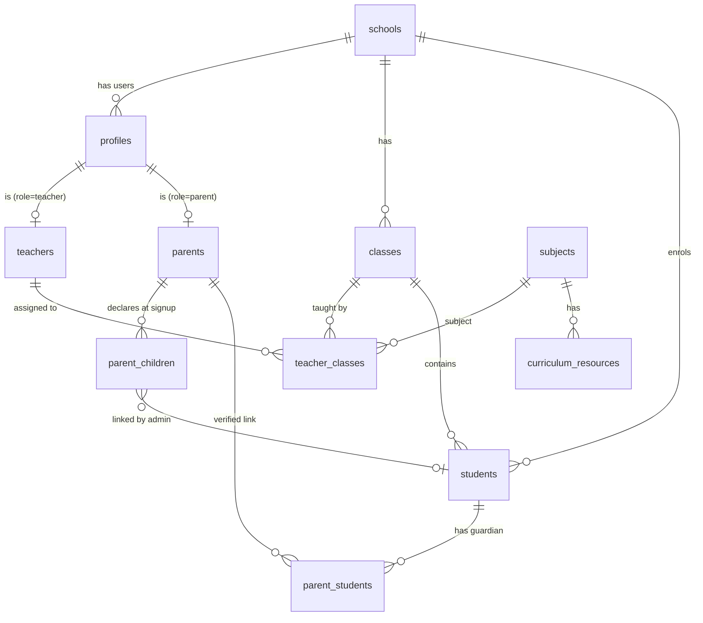

# Data model and access control

Run `supabase/migrations/001 → 002 → 003` in order in the Supabase SQL editor.

## Entity relationships

| Table | Purpose | Key columns |
|---|---|---|
| `schools` | Tenant. Every row of school data carries `school_id`. | `id, name, email, phone` |
| `profiles` (Users) | One row per auth user. | `id = auth.users.id, school_id, role (administrator/teacher/student/parent), status (unverified/pending/active/rejected), full_name, email, phone` |
| `teachers` | Teacher registration details. | `profile_id, school_id, subjects_taught text[], is_class_teacher, requested_class_label, approved_by, approved_at, rejection_reason` |
| `parents` | Parent registration. | `profile_id, school_id` |
| `parent_children` | Children a parent declared at signup (the verification queue). | `parent_id, child_name, class_label, student_id (set when linked)` |
| `students` | Enrolled students. | `school_id, class_id, admission_no, full_name, status` |
| `classes` | Class / grade. | `school_id, label, grade_level` |
| `teacher_classes` | What each teacher handles. | `teacher_id, class_id, subject_id, is_class_teacher` |
| `parent_students` | Verified parent-student link (what parents can see). | `parent_id, student_id, relation` |
| `curriculum_resources` | Links posted by subject teachers. | `subject_id, class_id, title, url` |

## Registration and approval flow

1. The form calls `supabase.auth.signUp` with the details as user metadata.
2. A trigger on `auth.users` creates the profile with status `unverified`.
3. When the email is confirmed a second trigger runs `complete_registration`:
   - **Administrator**: creates the school and activates the account (full admin access).
   - **Teacher / Parent**: status `pending`, rows created in `teachers` / `parents` / `parent_children`.
4. The admin approves or rejects in **Pending approvals** (`approve_teacher`, `reject_teacher`, `approve_parent`, `reject_parent`).
   Approving a parent links each child to an existing student (same name and class) or creates the student record.
5. Until the status is `active`, row-level security returns nothing and the app shows the "Awaiting admin approval" screen.

## RBAC summary

| Capability | Admin | Class teacher | Subject teacher | Parent |
|---|---|---|---|---|
| Approve registrations, directory, overview | yes | no | no | no |
| Edit everything in the school | yes | no | no | no |
| Class list with parent contacts | all | own class | list only, no contacts | no |
| Own timetable, attendance, grades | all | assigned classes | assigned classes and subjects | read-only, own children |

All of this is enforced in Postgres (RLS plus a restrictive `school_id = my_school_id()` policy on every table); the front end only hides what the database would refuse anyway.

## Known limitation

`books.id`, `fee_invoices.id` and `applicants.id` are still globally unique text keys, so two schools cannot reuse the same id there.
